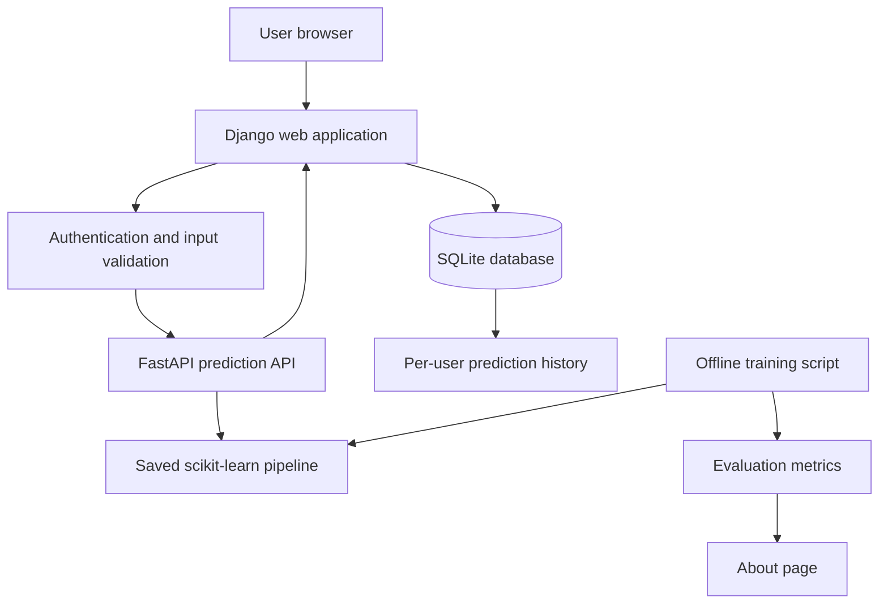

# Bank Term Deposit Predictor

A full-stack machine learning application that estimates whether a bank customer is likely to subscribe to a term deposit. The project combines a Django web application, a trained Random Forest pipeline, a FastAPI prediction service, and a database-backed prediction history.

## Overview

Bank telemarketing campaigns are resource-intensive, while only a minority of contacted customers subscribe. This application demonstrates how a supervised learning model can estimate subscription likelihood from customer and campaign attributes, then make the prediction workflow accessible through an authenticated web interface.

The model is trained offline by `ml/train_model.py`. The web application loads the saved model; it does not retrain the model during a user request.

## Application architecture



If the FastAPI service is unavailable or returns an unexpected response, the Django application can fall back to the same saved local model.

## Key features

- User registration, login, and logout using Django authentication.
- Protected dashboard with recent activity and project information.
- Prediction form with validation for 11 model inputs.
- Prediction result with probability and a plain-language outcome.
- Per-user prediction history with pagination.
- About page displaying evaluation metrics.
- Separate FastAPI service with `GET /health` and `POST /predict`.
- Local model fallback when the API is unavailable.
- Friendly handling of invalid inputs and missing model files.
- 56 automated tests covering accounts, views, model service, API client, and API service.

## Technology stack

| Layer | Technologies |
|---|---|
| Backend web application | Python, Django 5.1.4 |
| Machine learning | pandas, NumPy, scikit-learn, joblib |
| Model | Random Forest Classifier |
| Prediction API | FastAPI, Pydantic, Uvicorn |
| Database | SQLite (development) |
| Frontend | HTML, CSS, Bootstrap 5 |
| Configuration | python-dotenv |
| Testing | Django automated tests / Python test suite |

## Machine learning approach

| Item | Implementation |
|---|---|
| Problem | Binary classification |
| Target | Whether the customer subscribed (`yes` / `no`) |
| Algorithm | Random Forest (300 trees) |
| Class imbalance | `class_weight="balanced"` |
| Numeric features | `age`, `campaign`, `previous` |
| Categorical features | `job`, `marital`, `education`, `housing`, `loan`, `contact`, `month`, `poutcome` |
| Preprocessing | Median / most-frequent imputation and one-hot encoding |
| Split | Stratified 80/20 train/test split, `random_state=42` |
| Saved artifact | Preprocessing + estimator pipeline in `ml/model/model.joblib` |

The `duration` feature is deliberately excluded because call duration is only known after the call and would cause target leakage. Accuracy is not considered alone because the dataset is strongly imbalanced.

### Reported evaluation results

The following results are reported for one training run on 8,236 test records. They are project results, not a guarantee of performance on new or different banking data.

| Metric | Result |
|---|---:|
| Accuracy | 0.854 |
| Precision (subscriber class) | 0.394 |
| Recall (subscriber class) | 0.548 |
| F1 score | 0.459 |
| ROC-AUC | 0.774 |

Confusion matrix (rows = actual no/yes; columns = predicted no/yes):

```text
[[6525, 783],
 [ 419, 509]]
```

The training script writes the current run's results to `ml/model/metrics.json`.

## Dataset

The project uses the UCI Bank Marketing `bank-additional-full.csv` dataset, containing telephone campaign data from a Portuguese bank (May 2008–November 2010).

- Original data: 41,188 records and 21 columns.
- After removing 12 duplicate rows: 41,176 records.
- Target distribution: approximately 11.3% yes and 88.7% no.
- CSV separator: semicolon (`;`).

**Dataset reference:** S. Moro, P. Cortez and P. Rita, “A Data-Driven Approach to Predict the Success of Bank Telemarketing,” *Decision Support Systems*, 2014.

## Project structure

```text
manage.py
requirements.txt
.env.example
data/
  bank-additional-full.csv
ml/
  config.py
  train_model.py
  model/
    model.joblib
    metrics.json
accounts/
predictor/
api_service/
  app.py
notebooks/
templates/
static/
config/
```

## Run locally

Run commands from the project root (the directory containing `manage.py`). Python 3.11 or newer is required.

### 1. Create and activate a virtual environment

**Linux / macOS**
```bash
python3.11 -m venv venv
source venv/bin/activate
pip install -r requirements.txt
```

**Windows PowerShell**
```powershell
py -3.11 -m venv venv
.\venv\Scripts\Activate.ps1
pip install -r requirements.txt
```

### 2. Configure environment variables

Create a local `.env` file using a fresh secret key:

```bash
python -c "import secrets; print('DJANGO_SECRET_KEY=' + secrets.token_urlsafe(50))"
```

Copy the generated value into `.env`, and add:

```dotenv
DJANGO_DEBUG=True
DJANGO_ALLOWED_HOSTS=127.0.0.1,localhost
```

Never commit `.env` or share its contents. Use `.env.example` as a template only.

### 3. Initialize the database

```bash
python manage.py migrate
```

### 4. Train the model (optional)

A trained model is included in `ml/model/`. To reproduce training:

```bash
python ml/train_model.py
```

Restart the application after retraining because the model is loaded into the running process.

### 5. Start the Django application

```bash
python manage.py runserver
```

Open [http://127.0.0.1:8000/](http://127.0.0.1:8000/) and register an account to use the dashboard and prediction form.

### 6. Start the FastAPI service (optional separate terminal)

From the project root:

```bash
uvicorn api_service.app:app --host 127.0.0.1 --port 8001
```

- Health endpoint: [http://127.0.0.1:8001/health](http://127.0.0.1:8001/health)
- Interactive API docs: [http://127.0.0.1:8001/docs](http://127.0.0.1:8001/docs)

The Django application is designed to fall back to its local model if the API is unavailable.

## Example workflow

1. Register a user account and sign in.
2. Open the dashboard and choose **New prediction**.
3. Enter the customer and campaign attributes in the form.
4. Submit the form to receive a predicted subscription probability and outcome.
5. Open **History** to review previous predictions associated with the signed-in account.

The web form and API validate inputs against the project's configured feature choices. Use the form or the API documentation for the exact accepted request schema.

## Tests

Run the automated test suite from the project root:

```bash
python manage.py test
```

The accompanying project report records 56 automated tests across account workflows, views, model loading and prediction, API client behavior, and FastAPI endpoints.

## Screenshots and implementation evidence

Add screenshots from the actual running application to `docs/images/` and embed them below. Suggested evidence:

- Registration / login page
- Authenticated dashboard
- Prediction input form
- Prediction result page
- Prediction history
- FastAPI `/docs` and health response

Example Markdown once images have been committed:

```md


```

Only add real, sanitized screenshots. Do not include passwords, secret keys, private user data, or customer information.

## Limitations and future improvements

- The reported ROC-AUC is 0.774; the model has both false positives and false negatives.
- The dataset represents one Portuguese bank's historical campaigns from 2008–2010, so performance may not transfer to other banks, regions, or current campaigns.
- The system is an educational project and should not be used as the sole basis for real customer targeting or financial decisions.
- Future work could include external validation on newer data, model calibration, explainability, stronger deployment security, and monitoring for changes in incoming data and model performance.

## Author

Developed as an academic machine learning and web application project at Sunway College Kathmandu / Birmingham City University.
